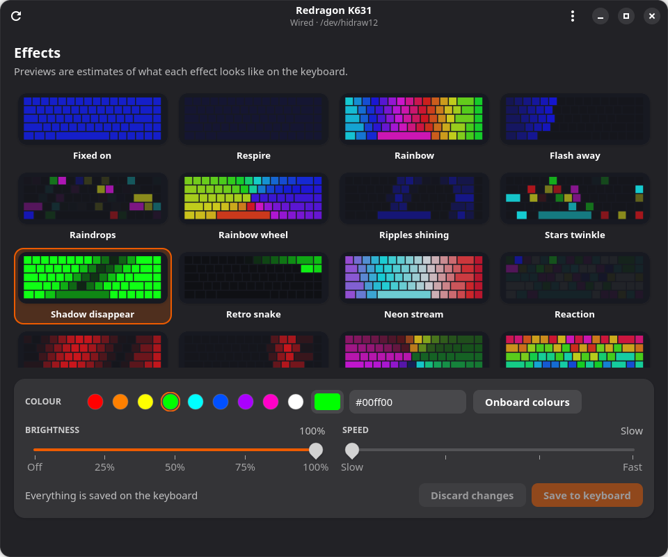
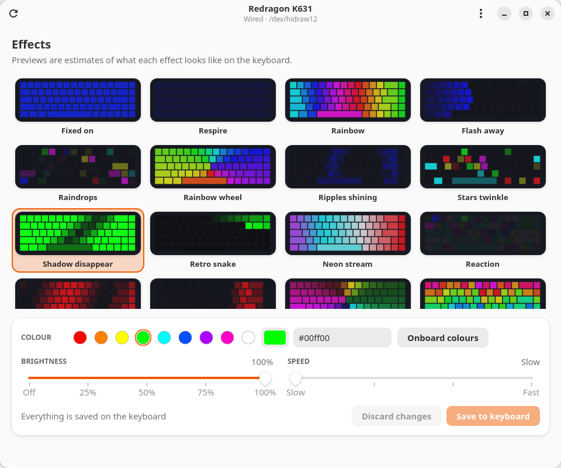

# Drakelight


Keyboard lighting control for the **Redragon K631** on Linux. Browse all 20 onboard effects as live animated
previews, pick a colour, brightness and speed, and save it to the keyboard. The settings live on the keyboard, so
nothing needs to keep running afterwards.

Drakelight is an unofficial, independent project and is not affiliated with Redragon.

<p align="center">
  
  
</p>

## Supported hardware

| | |
|---|---|
| Keyboard | Redragon K631, **wired USB-C mode** (USB ID `258a:0049`) |
| Not supported | 2.4 GHz receiver (`25a7:fa70`) and Bluetooth. The receiver exposes no lighting interface. |
| Desktop | GTK 4.10+ and libadwaita 1.5+ (Ubuntu 24.04+, Debian 13+, Fedora 40+) |

> **Read this before using it on another board.** `258a:0049` is shared by many Sinowealth-based keyboards from
> different brands, and their lighting memory layouts differ. A tool that assumed the wrong layout has bricked
> Redragon boards before. Drakelight reads the keyboard's configuration block first and refuses to write unless it
> matches the K631 layout exactly, changes at most three bytes per write, backs up the old settings before every
> write, and only ever sends four allow-listed commands. It has been tested on one physical K631. Use it at your own
> risk.

## Install

Download a package from the [latest release](../../releases/latest).

| Format | Install |
|---|---|
| `.deb` (Debian, Ubuntu) | `sudo apt install ./drakelight_*_all.deb` |
| `.rpm` (Fedora) | `sudo dnf install ./drakelight-*.noarch.rpm` |
| `.AppImage` (any recent distro) | `chmod +x Drakelight-*.AppImage && ./Drakelight-*.AppImage` |
| `.tar.gz` (source) | `tar xf drakelight-*.tar.gz && cd drakelight-* && sudo make install PREFIX=/usr` |

The `.deb`, `.rpm` and `make install` add an application menu entry, an icon and a udev rule. Remove a
tarball install with `sudo make uninstall PREFIX=/usr`.

The AppImage cannot install a udev rule, so on first run click **Enable access** in the app (or run
`./Drakelight-*.AppImage setup-access`). It asks for your password once. To add a menu entry for the AppImage, use
a tool such as Gear Lever or AppImageLauncher.

### Keyboard access

Linux hides the keyboard's configuration interface from normal users. The packages include a udev rule that
grants access to the active local user for this one USB ID. If the app says it has no permission, run
`drakelight setup-access` once and replug the keyboard.

## Use

Start **Drakelight** from the application menu, or run `drakelight`. Changes are previewed instantly and only
written to the keyboard when you press **Save to keyboard**.

Command line:

```
drakelight status                          # current effect, colour, speed, brightness
drakelight effects                         # list effects (and which take a colour)
drakelight set -e 9 -c ff0080 -s 3 -b 4    # effect 9, pink, speed 3, brightness 4
drakelight set -e 6 --colourful            # cycle the keyboard's onboard colours
drakelight restore                         # go back to the settings from before first use
drakelight dump                            # read-only hex dump of the config and colour blocks
```

The theme (follow system, light or dark) is in the app's menu.

### Recovery

Before every write the previous settings are saved to `~/.config/drakelight/backups/`. **Restore original
lighting** in the app menu (or `drakelight restore`) writes the oldest backup back. The keyboard's own factory
reset is **Fn + Esc** held for three seconds.

## How it works

The K631 stores its lighting in two 1 KiB blocks reachable through HID feature reports on the keyboard's vendor
interface: a configuration block (`C6`, holding the effect, plus a colour mode and speed/brightness byte for each
effect) and a colour table (`C8`). Drakelight reads the block, changes only the bytes you asked for, writes it back
and reads it again to confirm. The live previews are approximations of each effect, not a reproduction of the
firmware.

The block layout comes from the K631 notes in
[ahmad-bradii/Redragon_K631RGB-PRO_Setup](https://github.com/ahmad-bradii/Redragon_K631RGB-PRO_Setup) and was
checked against a read-only dump of a real keyboard. Other open-source projects that informed the approach:
[Syozik/Redragon-keyboard-linux-app](https://github.com/Syozik/Redragon-keyboard-linux-app) and
[wfoyt/Redragon-Control](https://github.com/wfoyt/Redragon-Control). No code was copied from them.

## Development

```
python3 -m venv .venv && .venv/bin/pip install pytest ruff
.venv/bin/pytest -q && .venv/bin/ruff check .
```

The GTK bindings come from your distro (`python3-gi`, `python3-gi-cairo`, `gir1.2-gtk-4.0`, `gir1.2-adw-1`), so the
launcher uses `/usr/bin/python3`. Run from a checkout with `PYTHONPATH=. /usr/bin/python3 -m drakelight`.

### Releasing

1. Bump `__version__` in `drakelight/__init__.py` and the release entry in
   `data/io.github.davidmakin.Drakelight.metainfo.xml`.
2. Commit, then `git tag vX.Y.Z && git push --tags`.

The **Release** workflow tests, builds the `.tar.gz`, `.deb`, `.rpm` and `.AppImage`, smoke-tests the AppImage and
the `.deb`, and publishes them with a `SHA256SUMS` file. Run it manually from the Actions tab to build the
packages without publishing.

## License

[MIT](LICENSE)
